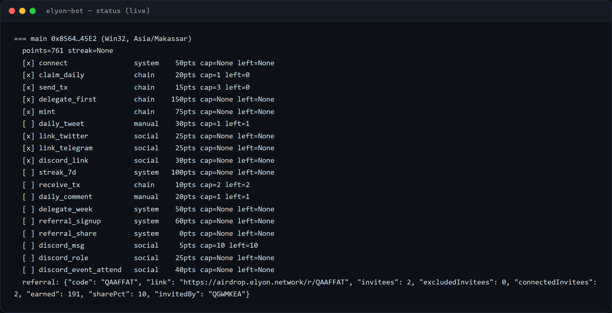
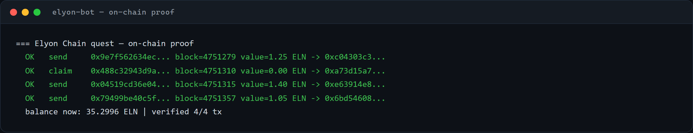

# Elyon-Bot

Automation for the **Elyon Chain incentivised testnet** (Season 1) quest platform.

Connects a self-custody EVM wallet to `airdrop.elyon.network`, completes the on-chain quests,
runs the live partner campaigns, and keeps the daily streak alive — no browser extension, no
manual clicking.

## Verified run

Live wallet state (addresses masked) and on-chain verification of the transactions the bot
actually executed — these cards are rendered from the bot's own output, not mockups:





## What it does

- **Sign-in** with an EIP-191 signature (SIWE-style message), session cookie cached per wallet
- **Faucet** claim once per campaign day
- **Transfers** 1+ ELN per day to prove the wallet can move funds
- **Badge mint** and **validator delegation** (10 ELN) as one-time quests
- **Partner campaigns** — auto-detects which quests are live and works them:
  referral sprint (verified every run), Instagram follow, daily secret code, X engagement
  (like/repost/comment/quote)
- **Anti-bot** — solves the platform's proof-of-work, SVG captcha grid and slider puzzles
  locally, no paid solving service
- Reads the quest ledger, points and rank back from the platform
- Multi-wallet config with per-wallet state

## Stack

Python 3.10+ · `eth-account` for local transaction signing · plain JSON-RPC ·
no web3.py, no Chrome, no paid captcha service.

## Design notes

- **Zero capital**: everything runs on testnet ELN from the site's own faucet.
- **Local keys**: private keys never leave `config.json`; transactions are signed locally.
- **Fleet-safe**: each wallet gets a stable device identity and its own humanised pacing so
  the fleet does not look like one script. Actions are jittered, daily caps are not always
  maxed, and wallets are staggered.
- **Idempotent**: already-claimed / already-minted / already-delegated states are detected
  before spending gas.
- **No fake submissions**: a campaign task that needs a real artefact (an IG handle, a today's
  secret code, your X comment link) is skipped with the reason printed, not submitted empty.

## Interface

Interactive Indonesian menu (`JALANKAN.bat`) plus a CLI:

```
python src/run.py --status       # points, tasks, referral, campaigns
python src/run.py --daily        # claim + send + live campaigns
python src/run.py --campaigns    # campaign quests only
python src/run.py --onboard      # mint + delegate
python src/run.py --dry-run      # plan only, no transactions

# campaign payloads (leave a flag out and that task is skipped, not faked)
python src/run.py --secret-code CODE         # daily secret code
python src/run.py --instagram handle         # instagram_follow task
python src/run.py --engage-url https://...   # your X comment link
python src/run.py --quote-url https://...    # your X quote link
```

## Status

Built and verified live on the Elyon testnet — daily loop and campaign quests confirmed
crediting points from real, server-accepted submissions. Maintenance repo: private.

---

Part of the **LYID** (Layer Airdrop ID) testnet automation collection.
Not affiliated with Elyon. Testnet only, no monetary value.
