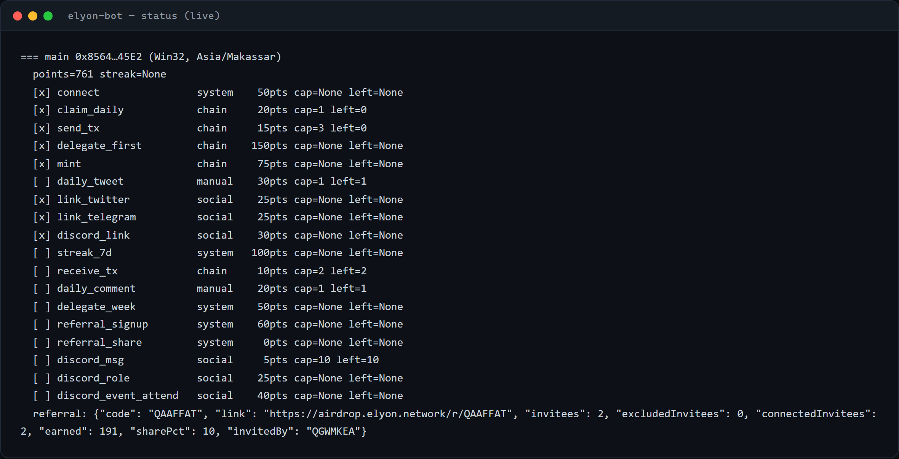
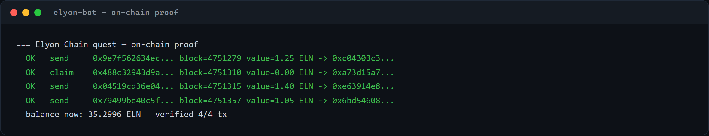

# Elyon Quest Bot

**Versi:** 1.3.0 · **Harga:** Rp 80.000 (~$5) · **Kontak pembelian:** [@rmndkyl](https://t.me/rmndkyl)

Bot otomatisasi untuk **Elyon Chain Testnet Season 1** (`airdrop.elyon.network`). Login lewat signature wallet, kerjakan quest on-chain, kumpulkan poin — tanpa browser, tanpa extension, tanpa modal (ELN testnet gratis dari faucet).

## Kebutuhan

| Item | Detail |
|---|---|
| Runtime | Node.js 18+ |
| Wallet | EVM / sesuai chain proyek (kamu sendiri) |
| Proxy | tidak perlu |
| Captcha | tidak perlu |
| Akses | akun proyek yang kamu kelola sendiri |

## Pembayaran

E-Wallet: DANA / GoPay / ShopeePay · Bank: BCA / Seabank · Crypto: contact for wallet address.
Pembeli menghubungi [@rmndkyl](https://t.me/rmndkyl), kirim bukti transfer, lalu terima license key.

---

Bot otomatisasi untuk **Elyon Chain Testnet Season 1** (`airdrop.elyon.network`).
Login lewat signature wallet, kerjakan quest on-chain, kumpulkan poin — tanpa browser,
tanpa extension, tanpa modal (ELN testnet gratis dari faucet).

---

## Bukti jalan (bukan mockup)

Status live wallet + verifikasi transaksi yang benar-benar dieksekusi bot:





Alamat wallet di gambar publik sudah disamarkan (`0xAbCd...1234`). Versi tanpa masking

---

## Apa yang dikerjakan bot ini

| Quest | Poin | Otomatis? |
|---|---|---|
| Connect wallet (sign-in SIWE) | 50 | ✅ sekali per wallet |
| Claim faucet ELN | 20 / hari | ✅ |
| Send 1 ELN ke address lain | 15 × 3 / hari | ✅ |
| Mint quest badge (on-chain) | 75 | ✅ sekali |
| Delegate 10 ELN ke validator | 150 | ✅ sekali |
| Stay delegated (mingguan) | 50 / minggu | ✅ pasif (stake tetap jalan) |
| Receive ELN | 10 × 2 / hari | ⚠️ butuh wallet kedua yang sudah aktif |
| Posting tweet harian | 30 / hari | ⚠️ butuh link post X (`--tweet-url`) |
| Daily comment di X | 20 / hari | ⚠️ butuh link komentar X (`--comment-url`) |
| Link X / Telegram / Discord | 25 / 25 / 30 | ⚠️ OAuth, bot kasih link-nya |
| Discord aktivitas / role / event | 5–40 | ❌ manual di server Discord |
| Referral signup | 60 / teman | ✅ otomatis dari referral code |
| **Partner / seasonal campaign** | 20–135 / campaign | ✅ click → tunggu `min_seconds` → claim (lihat bawah) |

Poin tidak dijamin jadi token — ini program poin testnet, bukan janji alokasi.

---

## Kebutuhan

| Item | Keterangan |
|---|---|
| Python | 3.10+ (`python --version`) |
| Paket | `eth-account`, `eth-utils` → `pip install -r requirements.txt` |
| Modal | **Rp 0** — ELN testnet dari faucet situs |
| Wallet | private key wallet EVM yang dipakai daftar |
| Email | sudah diverifikasi saat pendaftaran (aktivasi situs) |

Bot **tidak** butuh MetaMask, Chrome, atau API key pihak ketiga.

---

## Cara pakai (paling gampang)

1. Klik dua kali **`JALANKAN.bat`**
2. Pilih menu:
   - `1` cek status wallet
   - `2` jalankan tugas harian (bisa tempel link X kalau ada)
   - `3` setup sekali saja (mint + delegate)
   - `4` login ulang

## Cara pakai (command line)

```bash

python src\run.py --status      # lihat poin, tugas, referral, campaign
python src\run.py --daily       # claim + kirim ELN (maks 3x) + campaign yang live
python src\run.py --campaigns   # hanya campaign (partner quest, sprint, hunt)
python src\run.py --onboard     # setup yang kurang (mint + delegate)
python src\run.py --all         # setup yang kurang, lalu harian
python src\run.py --login       # refresh sesi saja
python src\run.py --proof       # verifikasi tx yang pernah dikirim (baca dari chain)

# opsi
python src\run.py --wallet main                 # hanya satu wallet (pakai label)
python src\run.py --tweet-url https://x.com/... # link post X hari ini
python src\run.py --comment-url https://x.com/... # link reply X hari ini
python src\run.py --engage-url https://x.com/...  # link KOMENTAR kamu (campaign daily-x-engagement)
python src\run.py --quote-url https://x.com/...   # link QUOTE kamu (campaign daily-x-engagement)
python src\run.py --secret-code KODE              # kode rahasia hari ini (override manual)
python src\run.py --no-code-scrape                # jangan ambil kode dari channel, pakai cache/config saja
python src\run.py --instagram usernamekamu        # sekali saja untuk task instagram_follow
python src\run.py --dry-run                       # rencanakan saja, tanpa transaksi
python src\run.py --no-skip                       # abaikan peluang "skip hari ini"
```

Contoh output nyata:

```
=== main 0x856456C9...45E2 (Win32, Asia/Makassar)
  points=711 streak=None
  balance 12.7497 ELN
    .. 2.2s (before claim)
  claim: 0x488c32943d9a0aa8... ok
  send 1.4 ELN -> 0xE63914E8... (1/2)
  send1: 0x04519cd36e04979a... ok
  points 711 -> 746 (rank 40389)
```

---

## Isi folder

```
elyon-bot/
├─ JALANKAN.bat          menu interaktif Bahasa Indonesia
├─ config.json           private key + opsi  (TIDAK di-commit)
├─ config.json.example   template
├─ src/
│  ├─ run.py             entry point + alur per wallet
│  ├─ antibot.py         PoW gauntlet + 428 loop + cookie session
│  ├─ captcha.py         parser & classifier captcha SVG (tanpa OCR)
│  ├─ reference.json     fingerprint 10 bentuk captcha
│  ├─ quest.py           wrapper API /v1/*
│  ├─ chain.py           JSON-RPC + signing lokal (tanpa web3)
│  ├─ humanize.py        fingerprint device, jitter, variasi perilaku
│  └─ probe.py           dump mentah task/poin/campaign (diagnosa)
└─ data/
   ├─ session_<addr>.json   cookie per wallet (jangan dibagikan)
   └─ last-run.json         laporan run terakhir
```

---

## Cara kerja teknis (ringkas)

**Login** — SIWE: `GET /v1/auth/nonce` → tanda tangan pesan
`"{domain} wants you to sign in with your wallet..."` → `POST /v1/auth/verify`.
Cookie sesi disimpan per wallet, jadi tidak perlu login ulang tiap run.

**Anti-bot (Elyon Sentinel v3)** — tiga lapis, semuanya sudah ditangani:
1. Proof-of-Work SHA-256: cari nonce sampai hash punya ≥ `bits` nol di depan (tier 0 = 16 bit, ±0,1 detik).
2. Per-action stamp: 428 `stamp_required` → header `x-elyon-stamp: <token>~<nonce>`.
3. Captcha grid 3×3: SVG-nya bukan gambar, tapi 9 glyph vektor. Bot mem-parse path/polygon,
   menghapus rotasi dari atribut `transform`, menormalkan skala, lalu mencocokkan invarian
   (jumlah vertex, radii, panjang sisi, luas) dengan `reference.json` → kirim `x-elyon-captcha-pass`.
4. Eskalasi tier 2–3 (`antibot_required`): kalau server menganggap satu aksi mencurigakan,
   428-nya berisi `{challenge, powPrefix, bits 21–24, puzzle}`. Bot menyelesaikan PoW-nya
   (10–30 detik) lalu mengirim solusi **slider puzzle** sintetis — `{pos, trace, dt}` dengan
   posisi di dalam `target ± tol`, 38–55 titik trace, easing + jitter — ke `/v1/antibot/solve`.
   Hasilnya pass tier 3 (ttl 20 menit, 30 uses) yang dipakai ulang untuk aksi berikutnya.

di Elyon Testnet (chainId `55452774`, RPC `https://testnet.elyon.network/rpc`):

| Fungsi | Selector | Dipakai untuk |
|---|---|---|
| `claim()` | `0x4e71d92d` | faucet harian |
| `mint()` | `0x1249c58b` | badge |
| `delegate(address)` payable | `0x5c19a95c` | stake 10 ELN |
| `undelegate()` | `0x92ab89bb` | lepas stake |

Transaksi ditandatangani lokal pakai `eth-account` lalu dikirim via `eth_sendRawTransaction` —
tidak ada web3.py, tidak ada node sendiri.

Poin tidak diklaim lewat endpoint: indexer Elyon membaca chain dan memberi poin otomatis
(±10–60 detik setelah transaksi masuk). Karena itu bot hanya perlu mengirim transaksi.

---

## Partner & seasonal campaign

Situs Elyon sekarang punya banyak **campaign** yang jalan bergantian: partner quest
(mis. *Unlock AI with ChainGPT*), sprint referral, hunt kode rahasia, dan daily X.
Bot membaca `GET /v1/campaigns`, ambil yang `state=live`, lalu untuk tiap task yang
masih terbuka menjalankan alur yang sama seperti front-end:

```
POST /v1/campaigns/{slug}/tasks/{id}/click     -> {claimableAt, serverMs}
tunggu (claimableAt - serverMs) + jeda manusia
POST /v1/campaigns/{slug}/tasks/{id}/complete  -> {status:"approved", points}
```

Task yang bisa dikerjakan sendiri oleh bot:

| Tipe task | Contoh | Status (v1.3.0) |
|---|---|---|
| `visit` | buka ChainGPT.org 15 detik | ✅ |
| `x_follow` | follow @Chain_GPT | ✅ (butuh X sudah ter-link) |
| `instagram_follow` | follow @elyonchain | ✅ kalau username IG diisi (`instagram` per wallet / `--instagram` / `instagram` di config) |
| `discord_join` (self) | join discord.gg/chaingpt | ✅ |
| `telegram_join` (self) | join @ChainGPT | ✅ |
| `telegram_join` (check=bot) | join @Elyon_chain | ✅ lolos begitu akun Telegram yang ter-link benar-benar join grup |
| `referral` | invite 3/10/100 teman | ✅ bot Verify tiap run — progres `N/M friends` tercatat di notes |
| `code` | kode rahasia harian | ✅ otomatis — bot ambil kode yang diposting hari ini di channel `@layerairdrop` (fallback `--secret-code`) |
| `x_engage` | like + repost + komentar post harian | ✅ kalau link komentar diisi (`--engage-url` + like/repost tercentang otomatis) |
| `x_quote` / `x_comment` / `x_post` | quote/reply/post harian | ✅ kalau link post diisi (`--quote-url`) |

Kalau task butuh aksi manusia, bot menulis alasannya di laporan (`notes`) dan tetap
lanjut ke task berikutnya — tidak pernah gagal total hanya karena satu task.

### Kode rahasia harian (`find-the-secret-code`)

Jawabannya cuma ada di gambar announcement, jadi bot tidak bisa menebak. Yang bot
lakukan: setelah kode dipecahkan dan diposting di channel `@layerairdrop`
(format `Enter Code : <link>` lalu kode di blok `code`), bot baca channel itu dan
kirim sendiri ke campaign. Urutan pengambilan kode:

1. `--secret-code KODE` (paling kuat, selalu menang)
2. environment `ELYON_SECRET_CODE`
3. cache `data/codes.json` — kode yang pernah di-approve hari itu (dipakai wallet berikutnya)
4. `config.json` → `"secret_codes": {"find-the-secret-code-4": "KODE"}`
5. scrape `t.me/s/layerairdrop` lalu `t.me/s/Elyon_chain`

Pesan channel yang lebih tua dari hari ini sengaja diabaikan supaya kode kemarin tidak
dipakai ulang. Sumber scrape bisa diganti lewat `"code_sources": ["https://t.me/s/..."]`
di `config.json`. Kalau belum ada kode hari itu, bot menulis di laporan
`no code for <slug> posted today` dan lanjut ke task lain — tidak menebak.

**Pitfall (kejadian nyata):** filter "hari ini" tetap bisa lolos untuk post kemarin
yang di-repost/reply hari ini, dan `data/codes.json` menyimpan kode itu dengan
`day = hari ini`. Hasilnya server menjawab `400 That code is not right.`
Pada hunt model baru (mis. `MASTER CODE HUNT: DAY 1 OF 3`) kode lama memang tidak
berlaku meski slug campaign-nya sama. Jadi: kalau announcement hari itu berbentuk
teka-teki gambar, pecahkan dulu, lalu jalankan
`python3 src/run.py --campaigns --wallet <label> --secret-code KODE --no-skip`
(`--no-skip` perlu kalau wallet sudah pernah jalan hari itu, karena skip human-variance
akan melewatinya).

### Auto-update: kode baru & task baru

Bot tidak perlu di-edit tiap kali Elyon ganti teka-teki. Yang jalan otomatis:

**1. Kode rahasia dipecahkan sendiri (`src/puzzle.py`)**

Announcement Elyon selalu punya baris teks bertopeng di caption:

```
EL?ON / CH12N        +      2 words · 10 letters · 3 missing
```

`puzzle.py` mengubah tanda `?` dan digit menjadi wildcard, menyusun ulang tiap
kata dari word list (`data/words/alpha.txt` + `freq.txt`), lalu memberi
peringkat: kata proyek (ELYON, CHAIN, HUNT…) dulu, baru frekuensi bahasa
Inggris. Digit diperlakukan dua kali: sebagai huruf kosong **dan** sebagai
*huruf bernomor* yang harus disimpan untuk Master Code multi-hari
(`data/master-code.json`). Telegram mengirim digit itu sebagai ①② / fullwidth,
jadi semua digit Unicode dinormalkan ke ASCII dulu.

Hasil uji pada tiga announcement terakhir: benar semua di peringkat 1 —
`TH? H?NT / BE?INS` → THEHUNTBEGINS, `W?LK AN? / DISC?VER` →
WALKANDDISCOVER, `EL?ON / CH12N` → ELYONCHAIN (nomor 1=A, 2=I).

**2. Kalau tebakan pertama salah, kode cadangan dicoba**

`codes.resolve_candidates()` mengembalikan daftar kandidat berurut. Task
dikirim dengan kandidat #1; kalau server menjawab `400 … is not right`, bot
klik ulang lalu kirim kandidat berikutnya (maksimal beberapa percobaan),
bukan menyerah untuk hari itu. Kode yang akhirnya `approved` yang di-cache —
bukan hasil scrape — jadi kode salah tidak lagi "meracuni" `data/codes.json`.

**3. Tipe task baru tidak lagi di-skip diam-diam**

Task dengan `type` yang belum dikenal dicatat di `data/unknown-tasks.json`
(slug, tipe, config, first/last seen, jumlah run) lalu dicoba dengan payload
kosong, karena sebagian besar task baru Elyon cuma butuh klik. Kalau server
menolak, jejaknya sudah ada untuk dijadikan handler khusus. Campaign baru
(slug baru) otomatis ikut karena daftarnya dibaca dari `GET /v1/campaigns`.

**4. Jadwal yang mengecek ulang**

| job | kapan | isi |
|---|---|---|
| `elyon-daily` | 08:10 | daily loop + campaign |
| `elyon-campaigns` | 10:40, 15:40, 21:40 | campaign saja (kode baru yang diumumkan siang/malam tetap ke-claim hari itu) |

Semua `no_agent`, jadi tidak memakai token model.

**Cek manual tanpa menyentuh wallet:**

```
python3 src/run.py --solve-code
# code      : ELYONCHAIN
# source    : solve:Elyon_chain/#143
# mask      : EL?ON / CH12N
# words     : ELYON CHAIN
# numbered  : 1=A, 2=I
# backups   : ELYONCHAWN, ELYONCHIAN, ...
```

Kalau suatu hari format announcement berubah dan solver tidak menemukan apa pun,
`--solve-code` keluar dengan pesan `no announcement puzzle found today`, dan
task-nya tetap bisa diselesaikan manual lewat `--secret-code KODE`.

Contoh nyata (wallet `main`, campaign ChainGPT):

```
  campaign 'Unlock AI with ChainGPT × Elyon' — 4/5 open
    + Follow Unlock AI with ChainGPT on X: approved (+20 pts)
    + Join Unlock AI with ChainGPT on Telegram: approved (+20 pts)
    + Join Unlock AI with ChainGPT on Discord: approved (+20 pts)
    + Explore Unlock AI with ChainGPT: approved (+20 pts)
    ! Join the Elyon Telegram group: 400 We can't see your Telegram account @... in @Elyon_chain yet
    campaign now 4/5 tasks, 80 pts
```

Sisa 1 task (Telegram Elyon) akan dicoba lagi otomatis di run berikutnya — begitu akun
Telegram yang ter-link benar-benar join `@Elyon_chain` dan `@ELNchain`, claim-nya langsung
lolos tanpa perlu buka browser.

---

## Humanisasi anti-sybil

Bot ini sengaja **tidak** berperilaku seperti skrip gabungan:

1. **Satu identitas stabil per wallet.** User-Agent, platform, resolusi, DPR, jumlah CPU/RAM,
   dan timezone dihitung deterministik dari address wallet. Wallet yang sama selalu tampil
   sebagai device yang sama; wallet berbeda tampil sebagai device yang berbeda.
2. **Perilaku bervariasi di dalam identitas.** Jeda antar aksi gaussian 1,2–6,5 detik,
   urutan aksi diacak, nominal kirim 1,0–1,4 ELN.
3. **Jumlah aksi tidak selalu maksimal.** Kirim per hari: 1 (45%), 2 (38%), 3 (17%).
4. **Ada hari kosong.** Peluang 8% wallet tidak melakukan apa-apa hari itu (`skip_rate`).
5. **Tidak pernah serempak.** Antar wallet diberi stagger acak; tidak ada dua wallet
   bertindak pada detik yang sama.

Yang **tidak** dilakukan bot dan sebaiknya juga tidak: membuat puluhan wallet dari satu
device untuk mendompleng referral sendiri. Aktivasi wallet baru di Elyon butuh email unik
+ device check, dan wallet bisa ditandai `excluded from the elyon campaign`.

---

## Troubleshooting

| Gejala | Sebab & solusi |
|---|---|
| `login failed: verify 401` | Sesi kedaluwarsa / cookie dihapus. Jalankan `--login`. |
| `captcha rejected` | Grid tidak cocok. Bot otomatis minta grid baru (maks 5×). Kalau sering, cek `reference.json`. |
| `claim: err: claim: cooldown` | Faucet sudah diklaim hari ini. Reset harian; coba lagi besok. |
| `mint: already minted` | Badge sudah ada. Normal. |
| `delegate: already delegated` | Sudah stake. Normal. |
| `insufficient funds` | Saldo ELN kurang. Bot minta gas otomatis; kalau tetap kurang, claim faucet dulu. |
| `transport ... forcibly closed` | Koneksi diputus Cloudflare. Client retry 3× otomatis; kalau tetap gagal, ulangi. |
| `unknown_label` di log captcha | Label captcha baru dari server. Tambahkan bentuknya ke `reference.json`. |
| `We can't see your Telegram account ...` | Task `telegram_join` dengan `check=bot`: akun Telegram yang ter-link belum join grup. Join sekali pakai akun itu; run berikutnya lolos otomatis. |
| `open_first` | Server belum mencatat klik link. Bot selalu `click` dulu, baru `complete` setelah `claimableAt`. |
| `escalated solve failed` / `bad_puzzle` | PoW atau slider tier 3 ditolak. Bot mengulang dengan challenge baru; kalau sering muncul, perbesar jeda antar aksi. |
| Poin tidak naik setelah tx | Indexer butuh waktu. Cek `--status` 1–2 menit kemudian. |

---

## Catatan biaya & keamanan

- Semua transaksi di **testnet** — ELN tidak punya nilai uang.
- `config.json` berisi private key asli: sudah masuk `.gitignore`, jangan pernah di-upload.
- `data/session_*.json` = cookie login wallet. Perlakukan seperti password.
- Bot tidak pernah mengirim aset ke address di luar yang kamu tentukan / address acak untuk quest `send`.

---

## Lisensi & kredit

Dibuat untuk LYID (Layer Airdrop ID) — pipeline bot farming testnet.
Dipakai sendiri, risiko ditanggung pemakai.